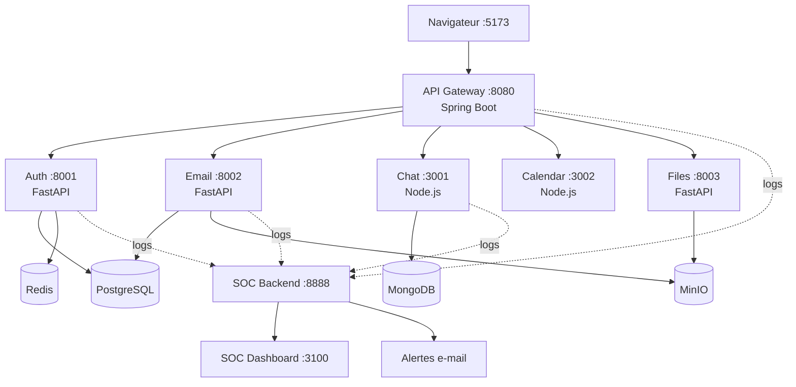

# WeMail — Plateforme e-mail d'entreprise avec SOC/SIEM intégré

> Plateforme e-mail d'entreprise en microservices, dotée d'un système SOC/SIEM maison qui détecte les attaques en temps réel et envoie des alertes automatiques.

  

Projet d'équipe réalisé à l'**ENSA Marrakech**.

---

## Fonctionnalités

- Messagerie avec pièces jointes (stockage objet)
- Chat en temps réel et calendrier
- Notifications
- **SOC/SIEM** : collecte des journaux de tous les services, détection d'attaques, tableau de bord d'alertes en temps réel et alertes automatiques par e-mail

---

## Architecture



---

## Stack technique

| Couche | Technologie |
|--------|-------------|
| Frontend | React 18 + Vite |
| API Gateway | Spring Boot 3.2 + Java 21 |
| Auth | FastAPI + PostgreSQL + JWT |
| Email | FastAPI + PostgreSQL + MinIO |
| Chat | Node.js + Socket.io + MongoDB |
| Calendar | Node.js + PostgreSQL |
| Files | FastAPI + MinIO |
| Notifications | Node.js + MongoDB |
| SOC Backend | FastAPI + MongoDB |
| SOC Frontend | React + Recharts |
| CI/CD | GitHub Actions |

---

## Sécurité et DevSecOps

Pipeline exécuté à chaque push :

```
Tests → SAST (Bandit) → Build Docker → Scan Trivy → Déploiement
```

Voir `.github/workflows/ci.yml`.

- Authentification par **JWT**
- Analyse statique du code Python avec **Bandit**
- Scan des images Docker avec **Trivy**
- Supervision de sécurité centralisée par le **SOC** maison, alimenté par les journaux de tous les services

---

## Installation rapide

**Prérequis :** Docker ≥ 24, Docker Compose ≥ 2, Node.js ≥ 18, Git.

```bash
# 1. Cloner le dépôt
git clone https://github.com/hiba05555/WeMail-SocWeMail.git
cd WeMail-SocWeMail

# 2. Lancer tous les services backend
docker compose up -d

# 3. Lancer le frontend WeMail
cd frontend/wemail-frontend
npm install && npm run dev

# 4. Lancer le dashboard SOC (nouveau terminal)
cd soc-platform/frontend
npm install && npm run dev -- --port 3100
```

## Accès

| Service | URL |
|---------|-----|
| WeMail (interface) | http://localhost:5173 |
| SOC Dashboard | http://localhost:3100 |
| API Gateway | http://localhost:8080 |
| SOC Backend | http://localhost:8888 |

Pour tester, créez un compte avec le bouton **Register** de la page de connexion. Aucun identifiant n'est fourni dans ce dépôt, volontairement.

---

## Équipe

Projet réalisé à l'ENSA Marrakech par Saad, Ismail, Wiam, Hiba et Malika.

## Contact

**Hiba Chagdaly**, GitHub : [@hiba05555](https://github.com/hiba05555)
